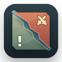

# DotaPing

**Dota-style desktop pings. macOS first.**

DotaPing brings a radial signal wheel, animated pings and sound to your Mac desktop.
It runs in the menu bar and places signals at your cursor's initial position.
Built with Swift and AppKit, with no third-party runtime dependencies.



## Platform and status

- macOS 13 or later; Apple Silicon is the currently validated architecture.
- Version 0.8.5, an experimental local app. Intel Macs are not yet validated.
- Windows and Linux are not supported. macOS is the first platform.
- Source release: this repository excludes Valve game images, audio and copied game reference files. A ready-to-install binary is not published at this stage.

## Controls

| Input | Action |
| --- | --- |
| Option + left click | Send a default ping |
| Option + left drag | Open the wheel; release to send at the initial cursor position |
| Return to center after dragging | Cancel |
| Right click, release Option, or add another modifier during the gesture | Cancel |
| ⌘⌥P | Open the fallback wheel |
| 1–8 in the fallback wheel | Attack, Assist, Defend, Friendly Ward, Enemy Ward, Heart, On My Way, Caution |
| Escape or center click in the fallback wheel | Cancel |

Dragging beyond the wheel continues selecting by direction. The fallback wheel closes after ten seconds.
The menu also provides a demo ping, sound toggle, gesture pause and Quit.

Option gestures require **System Settings → Privacy & Security → Accessibility → DotaPing**.
Then choose **Enable Option Gestures** from the app menu. The fallback shortcut does not require Accessibility.
Option gestures consume the click/drag, including Finder's Option-drag copying; use **Pause Ping Gestures** when you need that operation.

## Build locally

Install Xcode Command Line Tools (`xcode-select --install`), Swift 5.9+ and Python 3.
Clone this repository and run the following commands from its root.

First supply the assets you are entitled to use. To import a matching existing DotaPing project:

```sh
python3 tools/import-assets.py --source /absolute/path/to/existing/DotaPing
```

The importer checks every asset against the recorded SHA256 before copying. It imports the audio catalog and two game reference files needed by the verification scripts as well. It does not download assets or grant usage rights. See [asset requirements](docs/ASSETS.md).

```sh
python3 tools/verify-assets.py
python3 tools/verify-sounds.py
swift run PingCoreChecks
bash build.sh
python3 tools/verify-icon.py
dist/DotaPing.app/Contents/MacOS/DotaPing --self-test
open dist/DotaPing.app
```

The build creates an ad-hoc signed app in `dist/`. It is not Developer ID signed or notarized.
Updating or moving the app may require re-adding its Accessibility entry.
Do not disable Gatekeeper or remove quarantine as an installation step.

Core logic can be checked without game assets:

```sh
swift run --package-path CoreChecks PingCoreChecks
```

## Privacy and limitations

No network requests, game-process inspection, game injection, analytics, automatic updates or launch-at-login service are implemented.
The app observes mouse events and modifier changes for gestures; it does not record keystrokes.
Screen Recording permission is not needed. Sound preference and first-launch state are stored locally.

Particle rendering approximates the game's effects with AppKit; it is not the Source 2 particle engine.
Only the latest visual ping is displayed. Multidesktop synchronization is not implemented.
Fullscreen apps, physical multiple displays, capture-tool visibility, VoiceOver, macOS 13 runtime behavior and in-game/anti-cheat compatibility still need manual validation.
The gesture wheel may be clipped near display edges. Pause or quit before gaming until compatibility has been checked.

## Contributing and license

See [CONTRIBUTING.md](CONTRIBUTING.md) for checks and scope.
Original code, documentation and app/menu-bar icon artwork are under the [MIT License](LICENSE).
Valve game content is excluded from that license and from the public source tree.
See [THIRD_PARTY_ASSETS.md](THIRD_PARTY_ASSETS.md) for provenance and rights distinctions.

Inspired by [lolPing](https://github.com/darrenprx/lolPing), implemented independently.
Dota 2 and game content belong to Valve Corporation. This is an unofficial project and is not affiliated with or endorsed by Valve.
